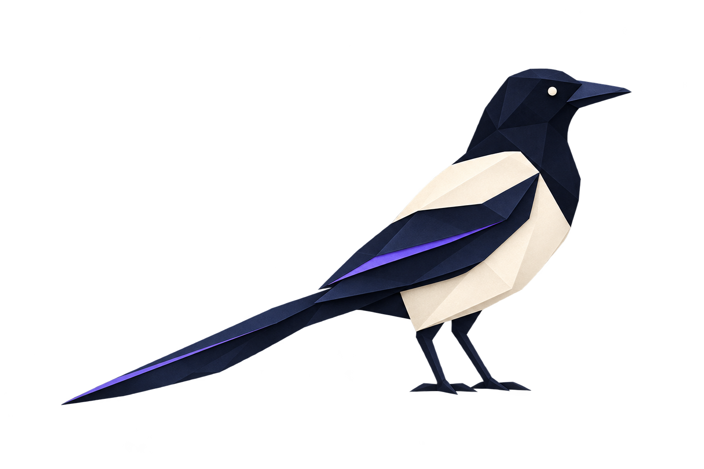

# Magpie mascot

A folded-paper Eurasian magpie for an Augmented Workflow sister site. The long tail and ivory shoulder patch distinguish it from [Wren](../wren/wren-alert.png). Navy paper and violet wing folds connect the two characters.

Open [the preview](preview.html) in a browser to play each animation on light and dark surfaces and download the assets.

| Asset | File | Size | Motion |
| --- | --- | --- | --- |
| Standing pose | [PNG](magpie.png) | 1536 × 1024 px | Still |
| Idle | [Animated WebP](magpie-idle.webp) | 768 × 512 px | Shifts its weight, blinks, and settles |
| Gather | [Animated WebP](magpie-gather.webp) | 768 × 512 px | Dips for a violet token and holds it in its beak |
| Takeoff | [Animated WebP](magpie-takeoff.webp) | 768 × 512 px | Crouches, pushes off, and opens into a glide |

All four assets have transparent backgrounds, the same 3:2 canvas, and matching starting placement. The WebPs play once and hold the final pose. Gather and Takeoff use stepped, illustrated poses.

## Use on a website

The standing PNG also works as the reduced-motion fallback. The following example uses the mascot as a decorative image.

```html
<picture>
  <source
    media="(prefers-reduced-motion: no-preference)"
    type="image/webp"
    srcset="magpie-idle.webp">
  
</picture>
```

## Artwork prompts

The built-in ImageGen tool generated the standing illustration and the key poses for Gather and Takeoff. The animation exports align and time those poses. Idle animates the standing illustration.

<details>
<summary>Standing pose</summary>

```text
Use case: logo-brand.
Asset type: a transparent website mascot master for an Augmented Workflow sister product. Reference image 1 is the existing Wren mascot, a style reference only. Create a new and instantly recognizable Eurasian magpie character from the same folded-paper design family.
Draw a single full-body magpie in its standing alert pose, on an actually transparent canvas. Clean right-facing side profile, relaxed folded wing, upright attentive head with a medium-long pointed black beak, stable stance on two slim dark feet. Most important species marks: a large ivory white scapular/shoulder patch visible above the dark folded wing, bright ivory belly separated from the black throat, glossy near-black head, and a very long straight graduated tail sweeping diagonally backward to the lower left, long enough to make the overall silhouette broad and unmistakably magpie. Let the body keep accurate slim magpie proportions with an approachable personality and a single small ivory eye highlight, no googly eyes.
Use crisp geometric origami construction in fine matte paper with restrained microtexture, a dark ink #111827 head and tail, warm ivory breast and shoulder, cool indigo shading, and a narrow electric violet #7C6CFF fold through the closed wing and tail. Let selected dim indigo edge facets gently separate the black plumage from a navy interface. The angular craftsmanship and restrained violet detail should echo the reference Wren.
Keep the entire relaxed silhouette centered with generous even transparent padding. Foot line flat. One complete bird only. No branch or scenery, no shadow below, no text, no logo, no framing, no thread or ribbon.
```

</details>

<details>
<summary>Gather poses</summary>

```text
Use case: illustration-story. Create a production sprite sheet of three pose drawings for the exact same Augmented Workflow origami magpie in reference image 1 (character model). Wide 3:1 layout in ONE ROW of THREE equal cells. Invisible grid, no text, no divider, transparent background. In each cell, fit one entire self-contained bird and leave at least 10% transparent margin around the whole drawing. Each frame preserves the same size, side profile facing right, tail length, paper construction, eye, distinctive ivory belly and scapular patch, and navy black with narrow violet folds. Preserve beak and feet. The feet remain planted at the same bottom-right relative location in all three tiles. Shape changes come from bending its body. From left to right: 1) the magpie bends its legs a little and looks diagonally down at the ground with bill pointed right and down. 2) the magpie dips very low, with its beak nearly touching the imaginary ground slightly ahead of its toes and its long leftward tail tipped up for balance. 3) the magpie lifts into the same upright stance shown in the reference with one tiny faceted violet rhombus held in the tip of the beak. Leave the rhombus absent in frames 1 and 2. No branch, floor, shadow, glow, text, ribbon, motion trails or effects. Render clean-edged single connected origami silhouettes ready for animation for a website.
```

</details>

<details>
<summary>Gather in-between poses</summary>

```text
Use case: illustration-story. Asset type: two in-between animation cels of the same origami magpie. Image 1 is the character model, image 2 is the approved three-pose gathering atlas, whose midpoint (middle cell) has beak to ground and whose last cell is standing with a violet token. Draw a transparent animation atlas with TWO equal cells side by side in a single very wide 3:1 landscape row, no visible grid. In both cells draw the same crouched half-dipped mid-action pose: feet planted level; body lean halfway from the first cell of reference 2 to the second cell; chin lowered near chest; beak aiming down and right, approximately half a torso-height above the feet; long tail sweeping up and to the left at a moderate angle. These two new cells should look just like the same pose repeated with one difference: left cell has an empty beak, right cell tightly holds the same tiny violet rhombus token as in the far-right cell of reference 2. Keep the reference's head and wing facets, long slender tail, slim feet, ivory/black plumage and narrow violet wing fold across the two drawings. Both birds should face right in identical side profile at equal scale with heads, tails and feet fully visible inside their cells. One distinct silhouette per cell with clear transparent gaps. No floor, shadows, glow, text, guides, trailing motion lines or scenery.
```

</details>

<details>
<summary>Takeoff poses</summary>

```text
Use case: illustration-story. Create a production four-pose transparent sprite atlas for the exact origami magpie in reference image 1 (character model). One landscape image with four equal cells in a TWO COLUMN by TWO ROW grid. Invisible dividers, no labels. Each cell shows the whole right-facing magpie with its unmistakable long straight leftward tail, white shoulder and breast, small ivory eye, black head and narrow workflow-violet wing fold. Keep beak, torso, and tail scale consistent, retaining the faceted folded matte paper look from the reference. Keep the torso centered at the same relative location in its cell, with fully separate transparent margins of at least 8% around every sprite. Row 1 left: low crouch ready to spring, feet visible and grounded, wings half-open and extended upward to a shallow V. Row 1 right: first full upstroke, one clearly visible broad folded-paper wing points diagonally up and back to the left above the bird, body rising toward the right, feet trailing. Row 2 left: powerful downstroke, the visible broad wing extends sharply down and back left and includes magpie's ivory wing patch, body rising toward the right, feet tucked. Row 2 right: airborne glide, a single near wing extends back and slightly up to the left in a long flattened triangular sail, feet tucked, slim tail straight and trailing left. Clean graphic poses and distinctive clear wing positions. No props, ground, scenery, halos, shadows, decorative marks, caption, logo, ribbon, motion lines, or extra figures.
```

</details>
